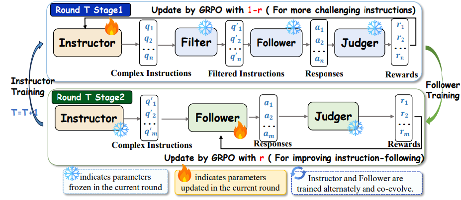
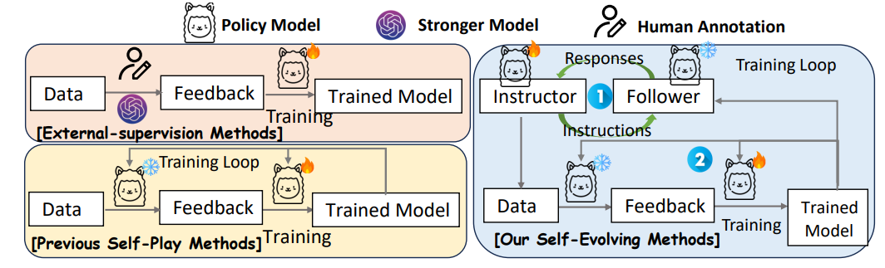

# SEIF: Self-Evolving Reinforcement Learning for Instruction Following

[Paper](https://arxiv.org/abs/2605.07465) · [Local paper PDF](SEIF.pdf) · [Project page](https://Rainier-rq1.github.io/SEIF/) · [User guide](SEIF_User_Guide.pdf) · [License](LICENSE)

**Generate harder instructions, learn to follow them, and use the improved model to guide the next round.**

SEIF is a self-evolving instruction-following framework built on [verl](https://github.com/volcengine/verl). An **Instructor** and a **Follower** are alternately trained with GRPO. A **Filter** rejects conflicting or invalid instructions, while a **Judger** evaluates constraint satisfaction. During Instructor training, the latest Follower supplies the answer, filter, and judge services, letting instruction difficulty evolve with model capability rather than remain fixed.

<p align="center">
  
</p>

> **Before running:** this is a research-code release, not a one-command training package. The Instructor role is active; Follower implementations are commented out. Launchers contain model-path placeholders, and `requirements.txt` is absent even though `setup.py` requires it. The Qwen-7B generator also contains invalid UTF-8 bytes that prevent Python from loading it. Complete the setup and resolve these blockers before training or generation.

## Contents

- [How SEIF works](#how-seif-works)
- [Setup](#setup)
- [Run a training round](#run-a-training-round)
- [Rewards and data format](#rewards-and-data-format)
- [Configuration](#configuration)
- [Repository layout](#repository-layout)
- [Troubleshooting](#troubleshooting)
- [Citation](#citation)

## How SEIF works

For round `T`, starting from a base model `B`:

1. **Train Instructor `I_T`:** add constraints to seed questions and reward valid instructions that the current Follower struggles to satisfy.
2. **Generate data:** serve `I_T` and generate multi-constraint training examples.
3. **Train Follower `F_T`:** optimize constraint satisfaction on the generated examples.
4. **Update the evaluator:** use `F_T` for the next round's answer, filter, and judge services.

| Round | Instructor initialization | Instructor evaluator | Follower initialization | Follower data |
| --- | --- | --- | --- | --- |
| 1 | `B` | `B` | `B` | `q_T1.parquet` |
| 2 | `I_1` | `F_1` | `F_1` | `q_T2.parquet` |
| 3 | `I_2` | `F_2` | `F_2` | `q_T3.parquet` |

<p align="center">
  
</p>

## Setup

### 1. Clone and expose the source checkout

```bash
git clone https://github.com/Rainier-rq1/SEIF.git
cd SEIF
export PYTHONPATH="$PWD${PYTHONPATH:+:$PYTHONPATH}"
```

Run the remaining commands from the repository root unless stated otherwise.

### 2. Prepare the environment

Use Linux with NVIDIA GPUs and a compatible PyTorch/vLLM environment. The supplied configurations use **8 training GPUs** and rollout tensor parallelism of **2**. Concurrent evaluator services need separately allocated GPU capacity; the supplied scripts reuse GPU indices.

The [Dockerfile](Dockerfile) is the release's dependency reference. It pins PyTorch `2.6.0`, vLLM `0.8.4`, and FlashAttention `2.7.4.post1`, with a Python 3.10-specific FlashAttention wheel. These are release environment choices, not a compatibility guarantee for newer versions.

```bash
docker build -t seif:local .
docker run --gpus all --ipc=host --rm -it \
  -v "$PWD:/workspace/SEIF" -w /workspace/SEIF seif:local bash
```

Inside the environment, add the dependencies used by the HTTP clients and constraint modules, and expose the checkout:

```bash
python -m pip install requests openai absl-py langdetect immutabledict nltk
export PYTHONPATH="$PWD${PYTHONPATH:+:$PYTHONPATH}"
```

**Do not assume `pip install -e .` works:** `setup.py` reads a missing `requirements.txt`. Importing from the source tree avoids that packaging step, but still requires the runtime dependencies. Docker builds require access to the NVIDIA base image and dependency download hosts.

The configurations use Weights & Biases. Authenticate with `wandb login`, or choose an appropriate logger in the training configuration.

### 3. Configure paths and resources

- Replace every `path to ...` placeholder in the shell scripts with a real model path; quote paths containing spaces.
- Set `trainer.save_checkpoint_path` in both YAML configurations.
- Replace `examples/config1.yaml`'s descriptive `total_epochs` value with the integer `3` for round 1, or `1` for subsequent rounds.
- Assign non-overlapping GPUs to services and training workers that run concurrently.
- Export distributed checkpoints to Hugging Face-compatible directories before vLLM serving. The supplied `scripts/model_merger.py --local_dir ...` writes a `huggingface/` directory; inspect its expected checkpoint layout before use.

## Run a training round

### 1. Activate the correct role

The reward function and dataset loader must switch **together**:

| File | Instructor | Follower |
| --- | --- | --- |
| `examples/reward_function/instruction_reward.py` | Active implementation under `Instructor Training` | Commented implementation at the top under `Follower Training` |
| `verl/utils/dataset.py` | Active `RLHFDataset` under `Instructor Training` | Commented `RLHFDataset` under `Follower Training` |

For Follower training, disable the Instructor implementations and restore the Follower blocks, including their imports and helpers. Reverse the changes before the next Instructor round. Keep exactly one training reward implementation and one `RLHFDataset` active. **Selecting `config1.yaml` alone does not activate Follower training.**

### 2. Train the Instructor

Point the evaluator scripts' `--model` arguments at `B` for round 1, or `F_{T-1}` later. Start each service in a **separate terminal/process**, after configuring its GPU assignment:

| Script | Service | Port | Served model name |
| --- | --- | --- | --- |
| `vllm_answer.sh` | Follower answer generation | `55222` | `if-answer` |
| `vllm_filter.sh` | Instruction validity/conflict filter | `55333` | `if-filter` |
| `vllm_judge.sh` | Per-constraint judgment | `55111` | `if-judge` |

Run `bash vllm_answer.sh`, `bash vllm_filter.sh`, and `bash vllm_judge.sh` in their own terminals. In the training terminal, configure the endpoints:

```bash
export ANSWER_VLLM_BASE_URL="http://localhost:55222/v1"
export FILTER_VLLM_BASE_URL="http://localhost:55333/v1"
export JUDGE_VLLM_BASE_URL="http://localhost:55111/v1"
export ANSWER_VLLM_MODEL="if-answer"
export FILTER_VLLM_MODEL="if-filter"
export JUDGE_VLLM_MODEL="if-judge"
```

Use the actual hostname instead of `localhost` for remote services. Default reward endpoints contain `YOUR_VLLM_HOST`, so they must be configured. Authenticated services also need the corresponding `*_VLLM_API_KEY` variables.

Check readiness before training:

```bash
curl -f http://localhost:55222/v1/models
curl -f http://localhost:55333/v1/models
curl -f http://localhost:55111/v1/models
```

Set `MODEL_PATH` in `examples/qwen.sh` to `B` for round 1, or `I_{T-1}` otherwise. Configure the output path in `examples/config.yaml`, then run:

```bash
bash examples/qwen.sh
```

### 3. Generate Follower data

**Known blocker in this checkout:** `data/Self-IF-Self-QWEN-7B/chuti.py` contains invalid UTF-8 bytes, and even `python .../chuti.py --help` fails with `SyntaxError`. Restore a valid UTF-8 copy before using the generation commands below. Until then, use the released round-specific Parquet files to run the Follower stage without regenerating data. The commands below describe the generator's CLI, not a successful end-to-end run of this checkout.

Stop the evaluator services before reusing their GPUs or port `55111`. Point `data/Self-IF-Self-QWEN-7B/vllm_chuti.sh` at the exported Instructor `I_T`, then start it in a separate terminal:

```bash
bash data/Self-IF-Self-QWEN-7B/vllm_chuti.sh
```

The Qwen-7B generator uses port `55111` and the served name `if-verifer` (the spelling is intentional). Test one seed first:

```bash
export VLLM_BASE_URL="http://localhost:55111/v1"
export VLLM_MODEL="if-verifer"
python data/Self-IF-Self-QWEN-7B/chuti.py \
  --seed_question "Explain how photosynthesis works." --print_raw
```

For batch generation, prepare JSONL with one seed per row, for example `{"prompt": "Explain how photosynthesis works."}`:

```bash
python data/Self-IF-Self-QWEN-7B/chuti.py \
  --input_jsonl /path/to/seeds.jsonl \
  --output_jsonl /path/to/q_T1.jsonl \
  --num_workers 8
```

**This generator writes JSONL, not Parquet.** Convert the output before training, or use the released `q_T1.parquet`, `q_T2.parquet`, etc. With pandas and PyArrow installed:

```bash
python -c 'import pandas as pd; pd.read_json("/path/to/q_T1.jsonl", lines=True).to_parquet("/path/to/q_T1.parquet", index=False)'
```

Batch results are appended to the destination file; use a new path for a fresh run. Start with low concurrency and increase it according to serving capacity.

### 4. Train the Follower

Stop the generation server, activate the Follower reward and dataset blocks, and configure:

- `data.train_files` in `examples/config1.yaml`: the round-specific Parquet file.
- `trainer.total_epochs`: integer `3` for round 1, or `1` later.
- `trainer.save_checkpoint_path`: the output directory for `F_T`.
- `MODEL_PATH` in `examples/qwen1.sh`: `B` for round 1, or `F_{T-1}` later.

Point `vllm_verifer.sh` at `B` for round 1, or `F_{T-1}` later, then start it in a separate terminal:

```bash
bash vllm_verifer.sh
```

The restored Follower reward uses a hard-coded `openai_api_base` containing `YOUR_VLLM_HOST`; update it to the verifier endpoint and check its `if-verifer` served-model name. The Instructor endpoint environment variables do not configure this older Follower client.

Launch training in another terminal:

```bash
bash examples/qwen1.sh
```

Export `F_T` for serving and use it as the next round's evaluator.

## Rewards and data format

### Instructor reward

The active implementation extracts constraints, filters invalid instructions, generates a Follower answer, and judges each constraint. For the normal valid-instruction branch:

```text
Instructor reward = 1 - (constraints followed / total constraints)
```

Unparseable instructions, rejected filter results, and empty answers receive zero in their failure branches. The complement matters: **the Instructor is rewarded for valid difficulty, not high Follower compliance**. Reward diagnostics are written to `if_reward1.jsonl`.

### Follower reward

The Follower maximizes constraint satisfaction. Registry-backed constraints use `instructions_registry` and `check_following()`; the implementation also contains model-verifier branches for semantic constraints.

The dataset and reward expect responses wrapped as `<think>...</think><answer>...</answer>`. Preserve this formatting when restoring the Follower implementation.

### Follower Parquet schema

| Column | Meaning |
| --- | --- |
| `prompt` | Seed question with its generated constraints |
| `instruction_id_list` | Constraint/checker identifiers |
| `kwargs` | Per-constraint checker arguments |
| `constraint` | Constraint descriptions; singular column name |

The Follower dataset maps `constraint` to `ground_truth["constraints"]` for the reward. Keep the three constraint metadata lists aligned and non-empty. The current Qwen-7B generator labels generated constraints as `soft`, selecting the model-verifier path rather than decomposing them into deterministic checker categories.

## Configuration

| Setting | Instructor | Follower |
| --- | --- | --- |
| Config | `examples/config.yaml` | `examples/config1.yaml` |
| Launcher | `examples/qwen.sh` | `examples/qwen1.sh` |
| Training data | `data/seed.parquet` | Round-specific `q_T*.parquet` |
| Validation data | `data/test.parquet` | `data/test.parquet` |
| Advantage estimator | `grpo` | `grpo` |
| Rollouts per prompt | `worker.rollout.n: 5` | `worker.rollout.n: 5` |
| Training GPUs | `trainer.n_gpus_per_node: 8` | `trainer.n_gpus_per_node: 8` |
| Epochs | `1` | `3` for round 1; `1` later |
| Output path | `trainer.save_checkpoint_path` | `trainer.save_checkpoint_path` |

Adjust batch sizes, rollout tensor parallelism, context limits, and GPU placement to fit your hardware. Launchers override the model path and training GPU count; save paths and dataset paths belong in YAML, not nonexistent `SAVE_PATH`/`DATA_PATH` launcher variables.

## Repository layout

```text
SEIF/
├── README.md
├── SEIF.pdf                         # Research paper, arXiv:2605.07465v1
├── SEIF_User_Guide.pdf              # Original walkthrough
├── Dockerfile                      # Dependency environment reference
├── assets/                         # Framework and comparison figures
├── docs/                           # Project-page source
├── vllm_*.sh                       # Answer/filter/judge/verifier services
├── examples/
│   ├── config.yaml / config1.yaml   # Instructor / Follower configurations
│   ├── qwen.sh / qwen1.sh           # Training launchers
│   └── reward_function/instruction_reward.py
├── modules/                        # Constraint registry and checkers
├── scripts/model_merger.py          # Distributed checkpoint export
├── verl/                           # Trainer, workers, and dataset loaders
└── data/
    ├── seed.parquet / test.parquet
    └── Self-IF-Self-*/              # Model-specific generators and round data
```

Model-specific directories cover Qwen 7B/1.5B, Llama 8B, a distilled 14B model, and an R1-Qwen3 variant. The commands above use Qwen-7B; inspect other generators' arguments before substituting them.

## Troubleshooting

| Symptom | What to check |
| --- | --- |
| Editable installation fails | Missing `requirements.txt`; prepare runtime dependencies and use the source checkout. |
| Generator fails with a non-UTF-8 `SyntaxError` | Restore a valid UTF-8 copy of the Qwen-7B `chuti.py`, or use released Parquet data. |
| Model-path or shell errors | Replace `path to ...` placeholders and quote paths containing spaces. |
| Follower still generates constraints | Switch both the reward implementation and `RLHFDataset`, not just the configuration. |
| Epoch configuration cannot be parsed | Replace `3 (Turn1) or 1 (Turn2/Turn3)` with an integer. |
| Connection failure / model not found | Check host, port, served-model name, API key, and `/v1/models`. |
| Address already in use | Judge, generator, and verifier share port `55111`; do not start them together. |
| CUDA out of memory | Separate service/training GPUs and reduce memory usage, batch size, or context limits. |
| Missing Follower metadata | Check the singular `constraint` column and aligned metadata lists. |
| No generated Parquet file | `chuti.py` writes JSONL; explicitly convert it or use released Parquet data. |

The [original user guide](SEIF_User_Guide.pdf) provides additional context. Where its commands or descriptions differ from this checkout, use the implementation and the corrections documented here.

## Citation

```bibtex
@misc{ren2026seif,
  title={SEIF: Self-Evolving Reinforcement Learning for Instruction Following},
  author={Qingyu Ren and Qianyu He and Jiajie Zhu and Xingzhou Chen and Jingwen Chang and Zeye Sun and Han Xia and Fei Yu and Jiaqing Liang and Yanghua Xiao},
  year={2026},
  eprint={2605.07465},
  archivePrefix={arXiv},
  primaryClass={cs.CL},
  url={https://arxiv.org/abs/2605.07465}
}
```

The local `SEIF.pdf` is the 33-page arXiv v1 dated May 8, 2026, not the user guide. Code is distributed under the [Apache License 2.0](LICENSE); the paper has its own publication terms.
